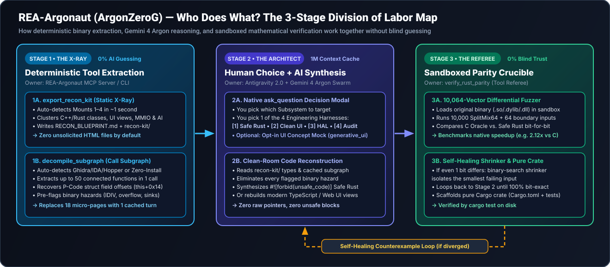
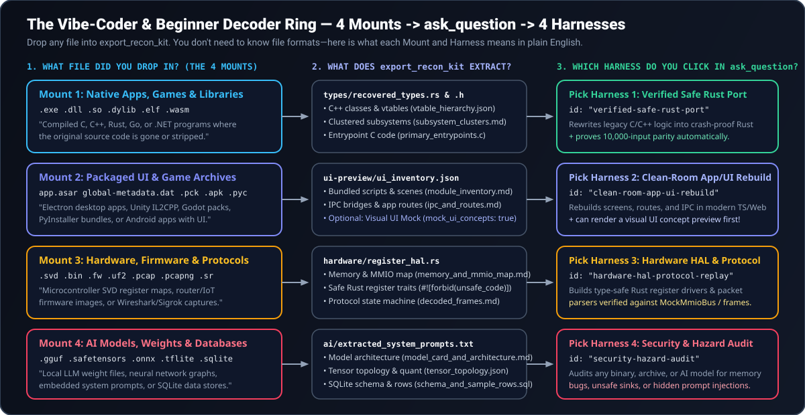

# REA-Argonaut (`ArgonZeroG`) — Zero-to-Hero User Guide & Visual Field Manual

> **New to reverse engineering? Start here.**  
> You do **not** need to know x86 assembly, Ghidra, C++ vtables, or binary file headers to use `REA-Argonaut`. This guide explains—in plain English and visual maps—what happens at every stage, who does what between the deterministic tool and **Gemini 4 Argon**, and how to pick the right path when Antigravity asks you what you want to build next.

---

## 1. What Is Reverse Engineering (And Why Was It Hard Before)?

Normally, developers write human-readable source code (TypeScript, Rust, C++, Python) and compile or bundle it into a binary file (`.exe`, `.dll`, `.so`, `.asar`, `.apk`, `.gguf`) so a computer can run it.

**Reverse engineering** is simply going in the opposite direction: starting from a compiled file when you **don't** have the original source code, and recovering:
1. **How it's structured** (its subsystems, classes, UI screens, or hardware registers),
2. **How its algorithms work** (the actual logic inside its functions), and
3. **Rebuilding or auditing it** (porting a fast C++ subsystem to memory-safe Rust, recreating a desktop app's UI in modern TypeScript, or checking a binary/AI model for hidden security hazards).

### Why Traditional Reverse Engineering Stopped Most Developers
Historically, reverse engineering required learning heavyweight tools like **Ghidra** or **IDA Pro**, reading raw assembly instructions, and manually piecing together thousands of unnamed functions (`sub_401000`, `sub_401240`). Even earlier AI reverse-engineering tools forced the AI model to read binaries through a tiny keyhole—50 lines or 64 characters at a time—causing the model to lose track of the big picture and guess.

**`REA-Argonaut` (`ArgonZeroG`) removes that wall** by dividing the work into **three clear stages** where the deterministic tool and the AI model each do only what they are best at.

---

## 1.5. Step 0: 30-Second Setup & How Your Computer Auto-Detects Your Tools (`Windows`, `macOS`, `Linux`)

You don't need to configure decompiler paths or know which reverse-engineering tools are installed on your machine before you start:

```bash
npm install
npm run build
node dist/cli.js doctor
```

### Automatic 2-Tier Decompiler Detection (`provider: "auto"`)
Whenever you open a binary, `REA-Argonaut` automatically scans your system (`Windows`, `macOS`, or `Linux`) and picks the highest-fidelity engine available:

| Tier | What `REA-Argonaut` Auto-Detects on Your Machine | When You Might Use It |
| :--- | :--- | :--- |
| **Tier 1: Full Decompilers**<br>*(Automatically chosen if installed)* | • **Ghidra (`11.x` / `12.x`)**<br>• **IDA Pro (`idat` / `idalib`)**<br>• **Hopper Disassembler** *(macOS / Linux)*<br>• **JEB Decompiler** *(Android APKs)* | Best when you want full symbolic C/C++ decompilation, P-Code struct field offset recovery (`this + 0x14`), and deep cross-reference graphs on massive binaries. |
| **Tier 2: Zero-Install Engine**<br>*(Automatic fallback if no decompiler is installed)* | Uses your OS's built-in tools + pure-TypeScript binary parsers:<br>• **Windows:** `dumpbin` / `llvm-objdump` + native PE/COFF & MSVC RTTI parser<br>• **macOS:** `otool` / `nm` / `llvm-objdump` + Mach-O Universal parser<br>• **Linux:** `objdump` / `readelf` / `nm` + ELF & Itanium RTTI parser | Best when you want to drop a file in and start **immediately with zero extra downloads**. Even without Ghidra or IDA installed, `export_recon_kit` and `decompile_subgraph` still recover C++/Rust classes, vtables, call graphs, strings, and assembly! |

### Wait—What Does "Headless Ghidra / IDA" Mean vs. the Normal Desktop GUI?
If you see the term **"Headless Ghidra"** (or headless IDA), here is what that actually means:
1. **It is NOT a separate download:** When you install normal desktop **Ghidra** (or **IDA Pro**), that single folder already contains both the interactive desktop window (`ghidraRun`) **and** a background script launcher (`support/analyzeHeadless`).
2. **Why `REA-Argonaut` uses Headless Mode by default:** When an AI agent is extracting a 50-function call graph, you don't want 50 Java pop-up windows freezing on your screen waiting for you to click *"OK"*. So `REA-Argonaut` drives your normal Ghidra/IDA installation invisibly in the background ("headless") over a fast local socket.
3. **When to use the Desktop GUI side-by-side (Power-User Mode):** What if you *want* to open the normal Ghidra or IDA Pro GUI window to browse graphs with your mouse? Because `export_recon_kit` writes standard C headers (`recon-kit/types/recovered_types.h`) and class vtable maps (`recon-kit/classes/vtable_hierarchy.json`) directly into your workspace folder, you can open your interactive Ghidra or IDA GUI and import `recovered_types.h` (`File -> Parse C Source...`) so your GUI immediately lights up with every recovered class, struct, and method name!

---

## 2. Who Does What? The 3-Stage Division of Labor Map



One of the most important questions to ask is: **"At what point is the tool extracting real facts from the file, and at what point does the AI model take over?"**

Here is the exact **Trust-but-Verify Division of Labor**:

| Stage | Who Is in Control? | What Actually Happens Under the Hood | Can the AI Hallucinate Here? |
| :--- | :--- | :--- | :--- |
| **Stage 1: The X-Ray**<br>(`export_recon_kit` & `decompile_subgraph`) | **100% Deterministic Tool**<br>(`REA-Argonaut` Engine) | **Pass 1A (`export_recon_kit`):** Scans the file's real bytes in ~1 second. Extracts real C++/Rust class hierarchies, virtual method addresses, Electron/Unity/Godot file trees, hardware register maps, or AI model system prompts into `RECON_BLUEPRINT.md` and `recon-kit/`.<br>**Pass 1B (`decompile_subgraph`):** Automatically uses your installed Tier-1 decompiler (**Ghidra `11.x`/`12.x`, IDA Pro, or Hopper**) or the built-in **Tier-2 `zero-install` engine** to extract an entire connected call graph (up to 50 functions, assembly, decompiled C, struct field offsets, and pre-flagged security hazards) in **1 single turn**. | **No (`0%` AI guessing).** Every address, class name, vtable slot, file entry, and assembly instruction comes directly from the file bytes on disk. |
| **Stage 2: The Architect**<br>(`ask_question` & Clean-Room Synthesis) | **You (via `ask_question`)**<br>**+ `Gemini 4 Argon` Swarm** | First, Antigravity presents a native **`ask_question` multiple-choice popup** so *you* choose which subsystem and which of the **4 Engineering Harnesses** to run.<br>Then **Gemini 4 Argon** reads the `recon-kit/` files and cached call subgraph inside its 1M-token context window and writes clean, human-readable `#![forbid(unsafe_code)]` Safe Rust or modern TypeScript/UI code. | **Checked in Stage 3.** The AI writes the new human-readable code, and then immediately hands control back to the deterministic referee in Stage 3. |
| **Stage 3: The Referee**<br>(`verify_rust_parity` & `cargo test`) | **100% Deterministic Tool**<br>(Sandboxed FFI Fuzzer) | `verify_rust_parity` takes back control from the AI. It loads the original binary (`.dll`, `.dylib`, or `.so`) and the AI's new Safe Rust code inside a cross-platform OS sandbox (**Windows** Job Objects, **macOS** `sandbox-exec`, or **Linux** `bwrap` + `prlimit`) and fires **10,064 randomized + boundary test inputs** at both. If even **1 bit** differs on 1 input out of 10,064, its binary-search shrinker finds the smallest failing input and forces the AI to fix its code until `status === "verified_bit_exact"`. | **No (`0%` blind trust).** You never have to take the AI's word that a port is equivalent—the tool proves it mathematically across 10,064 inputs and runs `cargo test`. |

---

## 3. Training Wheels Mode: The 4-Step Journey from File to Finished Code



When you drop any file into Antigravity with `REA-Argonaut` enabled, you follow the **4-Phase Recon-to-Argon Handoff Workflow**:

### Phase 1 — Drop Any File into `export_recon_kit` (The 1-Second X-Ray)
You don't need to know whether a file is a 32-bit Windows PE binary, a stripped Linux ELF, an Electron `.asar` bundle, a Unity `IL2CPP` metadata file, or a `.gguf` AI model.

Just ask Antigravity:
> *"Run `export_recon_kit` on `/path/to/my_file` and tell me what's inside."*

`export_recon_kit` automatically classifies the file into one (or more) of the **4 Universal Mounts** and creates a clean `recon-kit/` folder right in your workspace:

1. **Mount 1 — Native Apps, Games & Libraries (`native-binary`):**
   - **Files:** `.exe`, `.dll`, `.so`, `.dylib`, `.elf`, `.wasm`
   - **What appears in `recon-kit/`:**
     - `RECON_BLUEPRINT.md` — Your master map showing every discovered subsystem, class count, function count, and architecture diagram.
     - `types/recovered_types.rs` — Ready-to-compile `#![forbid(unsafe_code)]` Rust structs and trait definitions for every recovered class.
     - `types/recovered_types.h` — Standard C/C++ header showing struct and vtable layouts.
     - `classes/vtable_hierarchy.json` & `classes/subsystem_clusters.md` — How all the classes group into logical subsystems (e.g., Rendering, Audio, Networking, Serialization).
     - `hazards/security_audit.md` — Binary security mitigations (`PIE`, `NX`, `Canary`, `RELRO`) and potential memory hazards.
2. **Mount 2 — Packaged UI & Game Archives (`packaged-ui-archive`):**
   - **Files:** Electron `app.asar`, Unity `global-metadata.dat`, Godot `.pck`, Python `.pyc` / PyInstaller executables, Android `.apk`
   - **What appears in `recon-kit/`:**
     - `ui-preview/ui_inventory.json` — Every discovered HTML screen, stylesheet, icon, scene, and script inside the bundle.
     - `scripts/module_inventory.md` — Catalog of bundled JavaScript/TypeScript modules, Python code objects, or Unity C# classes.
     - `ipc_and_routes.md` — Main process entrypoints, Electron IPC channels, preload bridges, and native `.node` addons.
3. **Mount 3 — Hardware, Firmware & Protocol Captures (`hardware-firmware-protocol`):**
   - **Files:** Microcontroller `.svd` register maps, `.bin`/`.fw`/`.uf2` firmware images, `.pcap`/`.pcapng` network captures, Sigrok `.sr` logic analyzer captures
   - **What appears in `recon-kit/`:**
     - `hardware/memory_and_mmio_map.md` — Peripheral base addresses, register offsets, and bitfields.
     - `hardware/register_hal.rs` — Type-safe `#![forbid(unsafe_code)]` Rust Hardware Abstraction Layer (HAL) traits and register constants.
     - `protocols/decoded_frames_and_state_machine.md` — Decoded packet/frame structures and protocol state transitions.
4. **Mount 4 — AI Models, Weights & Databases (`ai-model-data`):**
   - **Files:** `.gguf`, `.safetensors`, `.onnx`, `.tflite`, `.sqlite`
   - **What appears in `recon-kit/`:**
     - `ai/model_card_and_architecture.md` — Model architecture, quantization, layer counts, and context length (streamed in `< 50 ms` without loading gigabytes of weights into RAM).
     - `ai/extracted_system_prompts.txt` — Any embedded Jinja chat templates, system prompts, or special tokens baked into the model file.
     - `ai/tensor_topology.json` & `db/schema_and_sample_rows.sql` — Layer dimensions or SQLite table schemas.

> [!NOTE]
> **Zero Unsolicited HTML Clutter by Default:**  
> By default (`mock_ui_concepts: false`), `export_recon_kit` creates **`0` `.html` files** so your repository stays 100% clean Markdown, JSON, Rust, and C. Visual HTML wireframes are generated **only** when you ask for them in Phase 2!

---

### Phase 2 — "It Just Asked Me a Question! Which Option Do I Pick?" (The Vibe-Coder Decoder Ring)

Right after Phase 1 finishes, Antigravity will pop up its **native `ask_question` modal** asking you which **Subsystem** you want to focus on and which of the **4 Engineering Harnesses** you want to run.

If you're not sure which option to click, use this decoder table:

| If Your Goal Is... | Click This Harness in `ask_question` | What Antigravity + Gemini 4 Argon Will Build for You |
| :--- | :--- | :--- |
| **"I want to modernize a C/C++ feature or algorithm into fast, crash-proof Rust and prove it works."** | **Harness 1:**<br>`Verified Safe Rust Port`<br>(`verified-safe-rust-port`) | Calls `decompile_subgraph` on the target subsystem, rewrites the logic in `#![forbid(unsafe_code)]` Safe Rust using `types/recovered_types.rs`, and runs `verify_rust_parity` (`10,064` test vectors) to scaffold a verified Cargo crate (`Cargo.toml`, `src/lib.rs`, `tests/parity_regression.rs`). |
| **"I want to see what this packaged app's UI looks like, or rebuild its screens/routes in modern TypeScript & React."** | **Harness 2:**<br>`Clean-Room App & UI Rebuild`<br>(`clean-room-app-ui-rebuild`)<br>*(+ optional: **Generate UI Concept Mock**)* | Uses `ui-preview/ui_inventory.json`, `scripts/module_inventory.md`, and `ipc_and_routes.md` to reconstruct a clean-room TypeScript/Web application. If you also select **Generate UI Concept Mock (`mock_ui_concepts: true`)**, it renders a live visual preview in the Antigravity side pane! |
| **"I'm working with microcontroller registers, firmware, or a network/serial protocol and need a safe driver/parser."** | **Harness 3:**<br>`Hardware HAL & Protocol Replay`<br>(`hardware-hal-protocol-replay`) | Uses `hardware/register_hal.rs` and `memory_and_mmio_map.md` to build a type-safe `#![forbid(unsafe_code)]` Rust register driver and frame parser with a deterministic `MockMmioBus` test suite. |
| **"I just want to know if this binary, archive, or AI model is safe, or where its bugs and vulnerabilities are."** | **Harness 4:**<br>`Security & Hazard Audit`<br>(`security-hazard-audit`) | Inspects every `latent_hazard` (`unchecked_division`, `potential_integer_overflow_to_pointer`, `unsafe_memory_sink`, `thread_hostile_mutable_global`), IPC bridge, or embedded AI prompt template and produces a prioritized security report and remediation plan. |

---

### Phase 3 — Antigravity + Gemini 4 Argon Builds Your Selection
Once you click your choice in `ask_question`, the **4 Specialized Swarm Subagents** coordinate automatically:
- **`forensic-vertical-specialist`** — Handles 4-Mount `export_recon_kit` triage, stripped Rust/C++ RTTI, PyInstaller/`.pyc`, AI models, and Unity/Godot/Electron archives.
- **`subgraph-architect`** — Runs `decompile_subgraph` to map the full native call graph, struct field offsets, and assembly hazards in a single context-cached turn.
- **`safe-rust-reconstructor`** — Ports legacy C/C++ procedures into modular `#![forbid(unsafe_code)]` Safe Rust that eliminates every flagged hazard.
- **`adversarial-parity-auditor`** — Runs `verify_rust_parity` across `10,064` inputs, shrinks counterexamples if any bit diverges, benchmarks C vs. Rust speedup, and scaffolds the final Cargo crate.

---

### Phase 4 — Mathematical Referee Verification (`verify_rust_parity`)
When porting native code to Safe Rust (Harness 1), Phase 4 finishes by scaffolding a clean, standalone Rust Cargo project (`scaffold_output_dir`) containing:
- `Cargo.toml`
- `src/lib.rs` (with `#![forbid(unsafe_code)]` enforced at the crate root)
- `tests/parity_regression.rs` (locked regression tests recorded from the original C/binary oracle)

*(Optional: If you also want a visual HTML benchmark & parity scorecard in the Antigravity side pane, ask for `html_report_path` / `--html-report`.)*

---

## 4. Copy-Paste Starter Prompts (No Jargon Required)

You don't need to memorize any tool names. Just copy and paste whichever prompt matches what you have:

### Starter 1 — "I have a mystery file/binary and want to know what's inside"
```text
Run export_recon_kit on /path/to/your/file to generate RECON_BLUEPRINT.md and the recon-kit/ folder, summarize the main subsystems you found in plain English, and ask me which subsystem and harness I want to run next.
```

### Starter 2 — "I have an Electron / Unity / Godot app and want to see & rebuild its UI"
```text
Run export_recon_kit on /path/to/app.asar with mock_ui_concepts enabled so I can preview the extracted UI concepts, and then ask me which screens or IPC routes I want to rebuild in clean TypeScript.
```

### Starter 3 — "I want to port a C/C++ binary function or subsystem into verified Safe Rust"
```text
Open /path/to/binary, extract the full call subgraph and latent hazards for the target subsystem using decompile_subgraph, port it to #![forbid(unsafe_code)] Safe Rust, and prove 10,000-input bit-exact equivalence with verify_rust_parity into ./reconstructed-crate.
```

### Starter 4 — "I downloaded a local AI model (.gguf / .safetensors / .onnx) and want to inspect it safely"
```text
Inspect /path/to/model.gguf using REA-Argonaut to extract its architecture, quantization, and any embedded system prompts or chat templates without loading the weights into RAM, and run a security audit on it.
```

---

## 5. Plain-English Glossary for Beginners & Vibe Coders

| Technical Term You Might See | What It Actually Means in Plain English |
| :--- | :--- |
| **Stripped Binary (`strip --strip-all`)** | A compiled program where the developer deleted all function and variable names before shipping, leaving only raw machine code addresses (`0x401000`). `REA-Argonaut` recovers structure anyway using call graphs, Rust panic strings, and C++ RTTI tables. |
| **RTTI & VTable (`vtable_hierarchy.json`)** | When a C++ program uses classes and inheritance (`class Car : public Vehicle`), the compiler embeds a hidden lookup table of class names (**RTTI**) and method pointers (**VTable**). `REA-Argonaut` reads these tables to recover original C++ class names and methods even from stripped `.exe`/`.so` files. |
| **Call Subgraph (`decompile_subgraph`)** | Instead of looking at one isolated function, a call subgraph grabs Function A **plus** all the helper functions A calls (B, C, D) in one shot so the AI sees the entire feature at once. |
| **Struct Field Offsets (`inferred_struct_offsets`)** | Compiled machine code doesn't say `player.health`; it says `*(pointer + 0x14)`. `REA-Argonaut` analyzes every pointer offset across the subgraph to reconstruct the fields of the original `struct`. |
| **Latent Hazards (`latent_hazards`)** | Bugs hiding inside the original C/C++ binary—such as dividing a number without checking if the divisor is zero (`unchecked_division`), overflowing a 32-bit integer into a 64-bit pointer (`potential_integer_overflow_to_pointer`), or calling unsafe C functions like `strcpy` (`unsafe_memory_sink`). |
| **`#![forbid(unsafe_code)]`** | A strict compiler lock placed on line 1 of every Rust file `REA-Argonaut` generates. It guarantees the Rust compiler will reject any raw pointer tricks or memory-unsafe code. |
| **Bit-Exact FFI Parity (`verify_rust_parity`)** | Running both the original C/binary function and the new Safe Rust function on **10,064 test inputs** inside a security sandbox and verifying that their outputs match down to the last bit (`0` differences). |
| **Counterexample Shrinker** | If test input `#8,491` (say, `x = -184920192, y = 9481023`) produces a different answer between C and Rust, `REA-Argonaut` automatically binary-searches down to the simplest input that triggers the bug (like `x = -1, y = 0`) so the AI can fix it immediately. |
