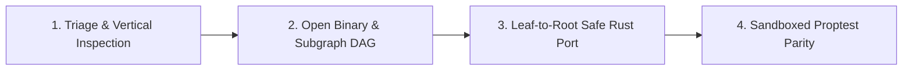

# ArgonZeroG End-to-End Decompilation & Parity Workflow

## 1. The 4-Phase ArgonZeroG Pipeline



---

## 2. Step-by-Step Tool Playbook

### Step 1: Pre-Decompilation Triage & Packing Check
Before opening a binary in a heavy decompiler backend, run `detect_packing_and_yara` and the relevant vertical inspector:
```json
{ "path": "/path/to/target_binary" }
```
- For **ELF** binaries (including versioned SONAME shared objects like `/lib/x86_64-linux-gnu/liblz4.so.1`), call `inspect_binary_layout` to inspect ELF headers, dynamic tags (`NEEDED`, `SONAME`, `RPATH`), security mitigations (PIE, NX, RELRO, Canary), and DWARF sections.
- For **Windows PE** binaries (`.exe`, `.dll`, `.sys`), call `inspect_pe_resources` and `inspect_rust_cpp_binary` (or `inspect_dotnet_assembly` for CLR binaries).
- For **macOS Mach-O** binaries (`.dylib`, `.bundle`, universal fat binaries), call `inspect_macho` and `inspect_rust_cpp_binary`.

### Step 2: Open Binary Session & Extract Subgraph (`decompile_subgraph`)
1. Open the binary with automatic backend tier selection (`radare2` r2pipe -> `ghidra` headless -> `objdump` -> pure-TS capstone fallback):
   ```json
   {
     "path": "/path/to/target_binary",
     "provider_id": "auto"
   }
   ```
   *(Note: `provider` is accepted as an alias for `provider_id`.)*
2. Retrieve high-level binary metadata and exported/internal procedures:
   ```json
   // binary_overview
   {}
   ```
   ```json
   // list_procedures
   { "filter": "compress", "limit": 50 }
   ```
3. Batch-decompile the entire call-graph subgraph in a single call:
   ```json
   {
     "procedure": "LZ4_compress_default",
     "max_depth": 3,
     "max_nodes": 50,
     "traversal": "bfs",
     "include_assembly": true
   }
   ```
   - `BinaryCacheStore` persists all decompiled procedures and call edges in SQLite WAL storage keyed by `binary_sha256`.
   - Inspect `topological_order` in the response to obtain the leaf-to-root reconstruction sequence.

### Step 3: Reconstruct in Safe `#![forbid(unsafe_code)]` Rust
Translate each procedure in `topological_order` from leaf helpers up to the root entrypoint:
- Replace raw C pointer arithmetic (`ptr + offset`, `*ptr++`) with idiomatic Rust slices (`&[u8]`, `&mut [u8]`) and checked indexing (`.get(offset)`).
- Preserve exact C integer semantics: use `.wrapping_add()`, `.wrapping_sub()`, `.wrapping_mul()`, `.wrapping_shl()`, and `.wrapping_shr()` whenever the assembly performs unchecked two's-complement arithmetic.

### Step 4: Prove Bit-Exact Equivalence (`verify_rust_parity`)
Verify each reconstructed Rust function against the native binary symbol (or C oracle) inside the `ParitySandboxRunner` container:
```json
{
  "target_binary_path": "/path/to/target_binary.so",
  "symbol_name": "target_symbol",
  "rust_source_code": "pub fn target_symbol(a: u32, b: u32) -> u32 { a.wrapping_add(b) }",
  "rust_fn_name": "target_symbol",
  "arg_types": ["u32", "u32"],
  "return_type": "u32",
  "iterations": 500,
  "seed": 42,
  "forbid_unsafe": true
}
```
- Confirm `status === "verified_bit_exact"`, `memory_safety.forbid_unsafe_enforced === true`, and `memory_safety.candidate_unsafe_blocks === 0`.
- Record `benchmark_telemetry.speedup_vs_c_oracle` in the final forensic report.
