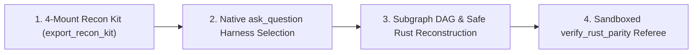

# ArgonZeroG End-to-End Decompilation, 4-Mount Recon Kit & Parity Workflow

## 1. The 4-Phase Recon-to-Argon Handoff & Modernization Pipeline



---

## 2. Step-by-Step Tool Playbook

### Step 1: Universal 4-Mount Recon Kit & Vertical Triage (`export_recon_kit`)
Before opening a binary in a heavy decompiler backend, materialize the **Universal 4-Mount Recon Kit** (`RECON_BLUEPRINT.md` + `recon-kit/`) and run the relevant domain inspector:
```json
{
  "path": "/path/to/target_binary",
  "output_dir": "/path/to/workspace/recon-output",
  "mount_override": "auto",
  "mock_ui_concepts": false
}
```
- **Mount 1 (`native-binary`)**: Automatically runs `inspect_rust_cpp_binary`, `inspect_go_binary`, `inspect_binary_layout`, `inspect_pe_resources`, and `decompile_subgraph` to populate `recon-kit/native/`.
- **Mount 2 (`packaged-ui-archive`)**: Automatically runs `inspect_engine_archive`, `inspect_python_frozen_binary`, `inspect_android_package`, `inspect_managed_artifact`, and `inspect_wasm_artifact` to populate `recon-kit/ui-archive/`.
- **Mount 3 (`hardware-firmware-protocol`)**: Automatically parses CMSIS-SVD, CAN `.dbc`, UF2, DeviceTree `.dtb` (`inspect_firmware_regions`, `extract_firmware`), PCAP (`inspect_packet_capture`, `inspect_web_network_capture`), and Sigrok captures (`decode_signal_recording`) into `recon-kit/hardware-protocol/`.
- **Mount 4 (`ai-model-data`)**: Automatically streams `.gguf`, `.safetensors`, `.onnx`, `.tflite` (`inspect_ai_model_artifact`), and SQLite (`inspect_sqlite_database`) into `recon-kit/ai-data/`.
- **Format-Specific Native Triage**:
  - For **ELF** binaries (including versioned SONAME shared objects like `/lib/x86_64-linux-gnu/liblz4.so.1`), call `inspect_binary_layout` and `inspect_rust_cpp_binary`.
  - For **Windows PE** binaries (`.exe`, `.dll`, `.sys`), call `inspect_pe_resources` and `inspect_rust_cpp_binary` (or `inspect_managed_artifact` for .NET CLR binaries).
  - For **macOS Mach-O** binaries (`.dylib`, `.bundle`, universal fat binaries), call `inspect_binary_layout` and `inspect_rust_cpp_binary`.

### Step 2: Native `ask_question` Harness Selection & Whole-Subgraph Extraction (`decompile_subgraph`)
1. Use Antigravity's native `ask_question` tool (never static HTML buttons) so the user selects which subsystem and which of the **4 Harnesses** (`verified-safe-rust-port`, `clean-room-app-ui-rebuild`, `hardware-hal-protocol-replay`, `security-hazard-audit`) to execute.
2. Open the binary with automatic 2-Tier backend selection (Tier-1 Headless Ghidra `11.x`/`12.x` when `GHIDRA_INSTALL_DIR` and `JAVA_HOME` are configured $\rightarrow$ Tier-2 `zero-install` engine combining pure-TypeScript ELF/Mach-O/PE parsers, host binutils, and built-in x86_64/ARM64 bytecode decoding):
   ```json
   {
     "path": "/path/to/target_binary",
     "provider_id": "auto"
   }
   ```
   *(Note: `provider` is accepted as an alias for `provider_id`.)*
3. Retrieve high-level binary metadata and exported/internal procedures:
   ```json
   // binary_overview
   {}
   ```
   ```json
   // list_procedures
   { "filter": "compress", "limit": 50 }
   ```
4. Batch-decompile the entire call-graph subgraph in a single round-trip:
   ```json
   {
     "procedure": "LZ4_compress_default",
     "max_depth": 3,
     "max_nodes": 50,
     "traversal": "bfs",
     "include_assembly": true
   }
   ```
   - Locks the entire connected call subgraph (`nodes`, `edges`, `cycle_edges`, `aggregated_strings`, `inferred_struct_offsets`, `latent_hazards`, `total_latent_hazards`) into the Gemini 4 Argon KV prompt context cache in one turn.

### Step 3: Reconstruct in Safe `#![forbid(unsafe_code)]` Rust
Translate each procedure in the subgraph from leaf helpers up to the root entrypoint:
- Replace raw C pointer arithmetic (`ptr + offset`, `*ptr++`) with idiomatic Rust slices (`&[u8]`, `&mut [u8]`) and checked indexing (`.get(offset)`).
- Eliminate every cataloged Stage 1 `latent_hazard` (`potential_integer_overflow_to_pointer`, `unchecked_division`, `thread_hostile_mutable_global`, `unsafe_memory_sink`, `uninitialized_or_stack_hazard`).
- Preserve exact C integer semantics: use `.wrapping_add()`, `.wrapping_sub()`, `.wrapping_mul()`, `.wrapping_shl()`, and `.wrapping_shr()` whenever the assembly performs unchecked two's-complement arithmetic.

### Step 4: Prove Bit-Exact Equivalence (`verify_rust_parity`)
Verify each reconstructed Rust function against the native binary symbol (or C oracle) inside the OS-isolated sandbox:
```json
{
  "target_binary_path": "/path/to/target_binary.so",
  "symbol_name": "target_symbol",
  "rust_source_code": "pub fn target_symbol(a: u32, b: u32) -> u32 { a.wrapping_add(b) }",
  "rust_fn_name": "target_symbol",
  "arg_types": ["u32", "u32"],
  "return_type": "u32",
  "iterations": 10000,
  "seed": 1337420,
  "forbid_unsafe": true
}
```
- Confirm `status === "verified_bit_exact"`, `memory_safety.forbid_unsafe_enforced === true`, and `memory_safety.candidate_unsafe_blocks === 0`.
- Optionally pass `scaffold_output_dir` to scaffold a pure `#![forbid(unsafe_code)]` Rust Cargo crate (`Cargo.toml`, `src/lib.rs`, `tests/parity_regression.rs`) with zero HTML clutter by default (and pass `html_report_path` only when an HTML parity dashboard is explicitly requested).
- Record `benchmark_telemetry.speedup_vs_c_oracle` in the final forensic scorecard.
