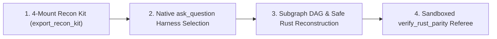

# ArgonZeroG End-to-End Decompilation, 4-Mount Recon Kit & Parity Workflow

## 1. The 4-Phase Recon-to-Argon Handoff & Modernization Pipeline



---

## 2. Step-by-Step Tool Playbook

### Step 1: Universal 4-Mount Recon Kit & Vertical Triage (`export_recon_kit`)
Before opening a binary in a heavy decompiler backend, materialize the **Universal 4-Mount Recon Kit** (`RECON_BLUEPRINT.md` + `recon-kit/`) and run the relevant domain inspector:
```json
{
  "path": "/path/to/target_binary",
  "output_dir": "/path/to/workspace/recon-output",
  "mount_override": "auto",
  "mock_ui_concepts": false
}
```
- **Mount 1 (`native-binary`)**: Uses `inspect_rust_cpp_binary` and RTTI/vtable analysis to populate `types/recovered_types.rs`, `types/recovered_types.h`, `classes/vtable_hierarchy.json`, `classes/subsystem_clusters.md`, `subsystems/primary_entrypoints.c`, and `hazards/security_audit.md` *(follow up with `inspect_go_binary`, `inspect_binary_layout`, `inspect_pe_resources`, and `decompile_subgraph`)*.
- **Mount 2 (`packaged-ui-archive`)**: Extracts UI/asset inventories, script/module catalogs, and IPC/route tables into `ui-preview/ui_inventory.json`, `scripts/module_inventory.md`, and `ipc_and_routes.md` (`ui-preview/index.html` is omitted unless `mock_ui_concepts: true`; follow up with `inspect_engine_archive`, `inspect_python_frozen_binary`, `inspect_android_package`, `inspect_managed_artifact`, and `inspect_wasm_artifact`).
- **Mount 3 (`hardware-firmware-protocol`)**: Extracts peripheral MMIO maps, safe Rust register HALs, and protocol state machines into `hardware/memory_and_mmio_map.md`, `hardware/register_hal.rs`, and `protocols/decoded_frames_and_state_machine.md` *(follow up with `inspect_firmware_regions`, `extract_firmware`, `inspect_packet_capture`, `inspect_web_network_capture`, and `decode_signal_recording`)*.
- **Mount 4 (`ai-model-data`)**: Streams `.gguf`/`.safetensors`/`.onnx`/`.tflite` headers and SQL metadata into `ai/model_card_and_architecture.md`, `ai/extracted_system_prompts.txt`, `ai/tensor_topology.json`, and `db/schema_and_sample_rows.sql` *(follow up with `inspect_ai_model_artifact` and `inspect_sqlite_database`)*.
- **Format-Specific Native Triage**:
  - For **ELF** binaries (including versioned SONAME shared objects like `/lib/x86_64-linux-gnu/liblz4.so.1`), call `inspect_binary_layout` and `inspect_rust_cpp_binary`.
  - For **Windows PE** binaries (`.exe`, `.dll`, `.sys`), call `inspect_pe_resources` and `inspect_rust_cpp_binary` (or `inspect_managed_artifact` for .NET CLR binaries).
  - For **macOS Mach-O** binaries (`.dylib`, `.bundle`, universal fat binaries), call `inspect_binary_layout` and `inspect_rust_cpp_binary`.

### Step 2: Native `ask_question` Harness Selection & Whole-Subgraph Extraction (`decompile_subgraph`)
1. Use Antigravity's native `ask_question` tool (never static HTML buttons) so the user selects which subsystem and which of the **4 Harnesses** (`verified-safe-rust-port`, `clean-room-app-ui-rebuild`, `hardware-hal-protocol-replay`, `security-hazard-audit`) to execute.
2. Open the binary with automatic 2-Tier backend selection (Tier-1 Headless Ghidra `11.x`/`12.x` when `GHIDRA_INSTALL_DIR` and `JAVA_HOME` are configured $\rightarrow$ Tier-2 `zero-install` engine combining pure-TypeScript ELF/Mach-O/PE parsers, host binutils, `SHT_RELR`/Android `APS2` relocation unpacking, `RegisterNatives` recovery, 5-class C++ linker-trap filtering, and built-in x86_64/ARM64 bytecode decoding):
   ```json
   {
     "path": "/path/to/target_binary",
     "provider_id": "auto"
   }
   ```
   *(Note: `provider` is accepted as an alias for `provider_id`.)*
3. Retrieve high-level binary metadata and exported/internal procedures:
   ```json
   {}
   ```
   *(Invoke `binary_overview({})` and `list_procedures({})` directly, or filter procedure names with `search_procedures`:)*
   ```json
   { "pattern": "compress" }
   ```
4. Batch-decompile the entire call-graph subgraph in a single round-trip (`decompile_subgraph`):
   ```json
   {
     "procedure": "LZ4_compress_default",
     "document": null,
     "max_depth": 3,
     "max_nodes": 50,
     "traversal": "bfs",
     "include_assembly": true
   }
   ```
   - Locks the entire connected call subgraph (`nodes`, `edges`, `cycle_edges`, `aggregated_strings`, `inferred_struct_offsets`, `latent_hazards`, `total_latent_hazards`), **per-node Stage 1.5 Reachability (`stage15_reachability`: `class_i_live_wired`, `class_ii_dead_fossil`, `class_ii_cloned_inline_suspect`, `linkage_edges`, `remediation_action`)**, and **binary-wide Linker Hygiene (`linker_hygiene`: `fvisibility_hidden_likely_omitted`, `intra_binary_plt_stubs`, `relr_relocations_decoded`, `jni_registered_methods_recovered`, `filtered_cpp_linker_traps`, `dlopen_targets`)** into the Gemini 4 Argon KV prompt context cache in one turn.
   - Across baseline vs. updated releases, pair with `compare_artifacts` and `find_changed_behavior` to catch **Class III Zombie Activation** (a formerly `class_ii_dead_fossil` procedure acquiring a live call/export/JNI/vtable edge).

### Step 3: Reconstruct in Safe `#![forbid(unsafe_code)]` Rust (`edition = "2024"`, `rust-version = "1.100"`)
Translate each procedure in the subgraph from leaf helpers up to the root entrypoint targeting `edition = "2024"` (`rust-version = "1.100"`) with `[lints.rust] unsafe_code = "forbid"`, `[lints.cargo] unused_dependencies = "warn"`, and `[lints.clippy]` denying `unwrap_used`, `expect_used`, `todo`, `unimplemented`, and `dbg_macro`:
- Replace raw C pointer arithmetic (`ptr + offset`, `*ptr++`) with idiomatic Rust slices (`&[u8]`, `&mut [u8]`) and checked indexing (`.get(offset)`).
- Apply **`rust-zero-drift`** type/resource patterns to eliminate **all 9 `latent_hazards` categories**:
  1. `potential_integer_overflow_to_pointer` -> promote index/stride math to `usize`/`u64` with `.checked_mul()` and checked slice access.
  2. `unchecked_division` -> guard zero divisors explicitly or use `.checked_div()` / `.checked_rem()`.
  3. `thread_hostile_mutable_global` -> replace `.bss`/`.data` globals with `std::sync::LazyLock` / `OnceLock` or an owned `&mut Context` / `Mutex` / `Atomic*`.
  4. `unsafe_memory_sink` -> replace `strcpy`/`strcat`/`sprintf`/`gets`/`scanf`/`system` with slice `.copy_from_slice()` and `std::fmt::Write`.
  5. `uninitialized_or_stack_hazard` -> replace oversized (`>= 4096`-byte) stack arrays with initialized `Vec<T>` or const-generic fixed-capacity structs (`struct Filter<const N: usize>`).
  6. `register_writeback_offset_clobber` -> map pre/post-indexed base pointer offsets into named Rust struct fields (`#[repr(C)]` or `#[repr(transparent)]` Newtypes).
  7. `null_deref_before_check` -> represent nullable C pointers as `Option<&T>` / `Option<&[u8]>` with `let ... else` guards and `PhantomData<State>` Typestate transitions.
  8. `size_truncation_or_unsigned_underflow` -> preserve `usize` with `TryFrom` and `.checked_sub()`.
  9. `unpopulated_out_param_or_duplicate_call` -> consolidate duplicate calls and zeroed stack out-params into structured return tuples or `Result<T, E>`, with `core::mem::DropGuard` for transactional cleanup on early `?` returns.
- Emit **Dual-Oracle sources**:
  - Primary bit-exact oracle (`rust_source_code` -> `<fn>`): preserve exact C integer promotion, two's-complement wrapping (`.wrapping_add()`, `.wrapping_sub()`, `.wrapping_mul()`, `.wrapping_shl()`, `.wrapping_shr()`), and IEEE-754 evaluation order.
  - Remediated safe sibling (`remediated_rust_source_code` -> `<fn>_remediated`): eliminate discovered `latent_hazards` with checked/saturating arithmetic and `rust-zero-drift` guardrails.

### Step 4: Prove Bit-Exact Equivalence & Verify Scaffolded Crate (`verify_rust_parity`)
Verify each reconstructed Rust function against the native binary symbol (or C oracle) inside the OS-isolated sandbox:
```json
{
  "target_binary_path": "/path/to/target_binary.so",
  "symbol_name": "target_symbol",
  "rust_source_code": "pub fn target_symbol(a: u32, b: u32) -> u32 { a.wrapping_add(b) }",
  "remediated_rust_source_code": "pub fn target_symbol_remediated(a: u32, b: u32) -> Option<u32> { a.checked_add(b) }",
  "rust_fn_name": "target_symbol",
  "arg_types": ["u32", "u32"],
  "return_type": "u32",
  "iterations": 10000,
  "seed": 1337420,
  "forbid_unsafe": true,
  "scaffold_output_dir": "/path/to/workspace/target_symbol_rs"
}
```
- Confirm `status === "verified_bit_exact"`, `memory_safety.forbid_unsafe_enforced === true`, and `memory_safety.candidate_unsafe_blocks === 0`.
- When `scaffold_output_dir` is supplied, `verify_rust_parity` scaffolds a pure `#![forbid(unsafe_code)]` Rust `1.100` (`edition = "2024"`) Cargo crate (`Cargo.toml`, `src/lib.rs` containing `<fn>` + `<fn>_remediated`, `tests/parity_regression.rs`) with zero HTML clutter by default (`scaffolded_crate.rust_edition === "2024"`, `zero_drift_lints_enforced === true`, `dashboard_html_path === null` unless opt-in `html_report_path` is provided).
- Run `cargo clippy --all-targets -- -D warnings` and `cargo test` inside `scaffold_output_dir` to certify zero Clippy warnings and green regression tests.
- Record `benchmark_telemetry.speedup_vs_c_oracle` in the final forensic scorecard.
