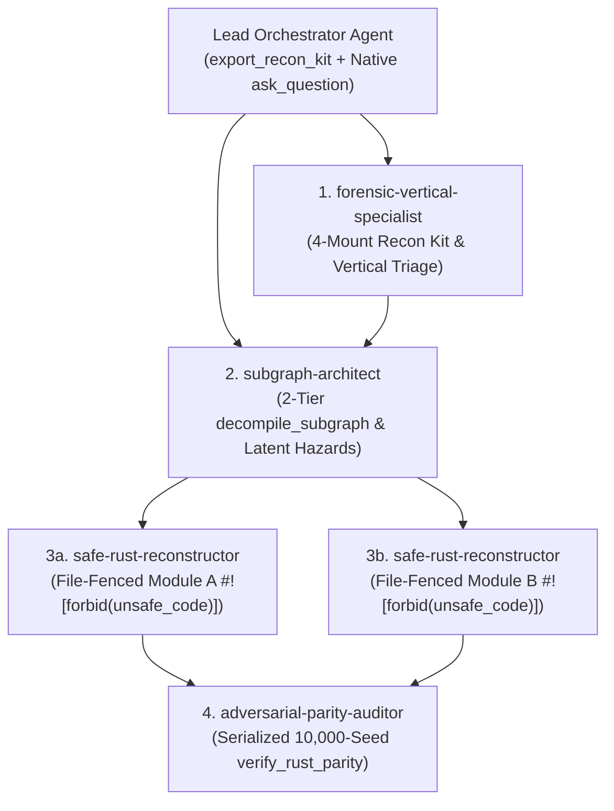

# Antigravity 2.0 Hub-and-Spoke Super-Swarm Orchestration Guide

`ArgonZeroG` ships 4 domain-specialized Antigravity 2.0 subagents in `plugins/rea-argonaut/agents/` to parallelize execution-free binary triage, whole-subgraph extraction, `#![forbid(unsafe_code)]` Rust reconstruction, and adversarial property-based parity auditing.

---

## 1. The 4 Bundled Swarm Subagents

| Agent Name | Definition File | Primary Responsibility | Canonical MCP Tools Used |
| :--- | :--- | :--- | :--- |
| **`forensic-vertical-specialist`** | `agents/forensic-vertical-specialist.md` | Rapid execution-free triage via the Universal 4-Mount Recon Kit (`export_recon_kit`) and specialized binary/archive/model verticals. | `export_recon_kit`, `inspect_rust_cpp_binary`, `inspect_python_frozen_binary`, `inspect_ai_model_artifact`, `inspect_engine_archive`, `inspect_go_binary`, `inspect_wasm_artifact`, `inspect_android_package`, `inspect_managed_artifact`, `inspect_evm_interface`, `inspect_firmware_regions`, `extract_firmware`, `inspect_packet_capture`, `inspect_web_network_capture`, `decode_signal_recording`, `inspect_sqlite_database`, `inspect_binary_layout`, `inspect_pe_resources`, `inspect_recorded_crash`, `inspect_artifact` |
| **`subgraph-architect`** | `agents/subgraph-architect.md` | Opens native binaries with 2-Tier resilience (`provider_id: "auto"`), extracts connected call subgraphs via `decompile_subgraph`, recovers `inferred_struct_offsets`, and catalogs `latent_hazards`. | `open_binary`, `binary_overview`, `list_procedures`, `inspect_rust_cpp_binary`, `decompile_subgraph`, `analyze_function`, `procedure_pseudocode`, `procedure_disassembly`, `procedure_callers`, `procedure_callees`, `search_strings`, `search_procedures`, `search_symbols`, `close_binary` |
| **`safe-rust-reconstructor`** | `agents/safe-rust-reconstructor.md` | Translates Stage 1 `decompile_subgraph` dossiers and `latent_hazards` censuses into `#![forbid(unsafe_code)]` idiomatic Rust within a strict module file fence. | `decompile_subgraph`, `analyze_function`, `procedure_pseudocode`, `procedure_disassembly`, `procedure_callers`, `procedure_callees`, `search_strings`, `verify_rust_parity` |
| **`adversarial-parity-auditor`** | `agents/adversarial-parity-auditor.md` | Runs serialized `10,000+` seed `verify_rust_parity` FFI fuzzing inside OS sandboxes, shrinks counterexamples, benchmarks C vs. Safe Rust speedup, and scaffolds pure `#![forbid(unsafe_code)]` Cargo crates. | `verify_rust_parity`, `decompile_subgraph`, `analyze_function`, `procedure_disassembly` |

---

## 2. Hub-and-Spoke Swarm Execution Topology

---

## 3. Swarm Coordination Protocol

### Phase A: Parallel Read-Only Discovery (`forensic-vertical-specialist` + `subgraph-architect`)
Spawn `forensic-vertical-specialist` and `subgraph-architect` concurrently:
- `forensic-vertical-specialist` runs `export_recon_kit` (with `mock_ui_concepts: false` by default) or the domain-specific vertical inspector (`inspect_rust_cpp_binary`, `inspect_python_frozen_binary`, `inspect_ai_model_artifact`, `inspect_engine_archive`, etc.) to identify compiler toolchains, RTTI/VTables, embedded scripts, and security mitigations.
- `subgraph-architect` calls `open_binary({ path, provider_id: "auto" })`, `binary_overview({})`, `list_procedures({})`, and `decompile_subgraph({ procedure, max_depth: 3, max_nodes: 50, traversal: "bfs", include_assembly: true })` to produce the Stage 1 subsystem dossier (`inferred_struct_offsets` + `latent_hazards`).

### Phase B: Parallel File-Fenced `#![forbid(unsafe_code)]` Reconstruction (`safe-rust-reconstructor`)
Assign each independent subsystem module to a `safe-rust-reconstructor` instance with a strict directory/file fence:
- Each `safe-rust-reconstructor` edits only files inside its assigned fence and enforces `#![forbid(unsafe_code)]` (`candidate_unsafe_blocks === 0`).
- Every Stage 1 `latent_hazard` (`potential_integer_overflow_to_pointer`, `unchecked_division`, `thread_hostile_mutable_global`, `unsafe_memory_sink`, `uninitialized_or_stack_hazard`) is systematically replaced with checked or wrapping safe Rust constructs.

### Phase C: Serialized `verify_rust_parity` & Self-Healing Loop (`adversarial-parity-auditor`)
Hand the candidate Rust source and target symbols to `adversarial-parity-auditor` one subsystem at a time so CPU-bound `rustc -C opt-level=3` compilation and `100,000`-iteration micro-benchmarks never contend for CPU cores:
- The auditor runs `verify_rust_parity` with `forbid_unsafe: true` and `iterations: 10000` (plus `64` boundary vectors).
- If `status === "diverged"`, the auditor relays `counterexample.shrunk_inputs`, `counterexample.c_output_hex`, `counterexample.rust_output_hex`, and `counterexample.bit_diff_summary` back to `safe-rust-reconstructor` for immediate self-healing.
- When `scaffold_output_dir` is supplied, `verify_rust_parity` scaffolds a pure `#![forbid(unsafe_code)]` Cargo crate (`Cargo.toml`, `src/lib.rs`, `tests/parity_regression.rs`) with zero HTML clutter by default (`html_report_path` is strictly opt-in).
