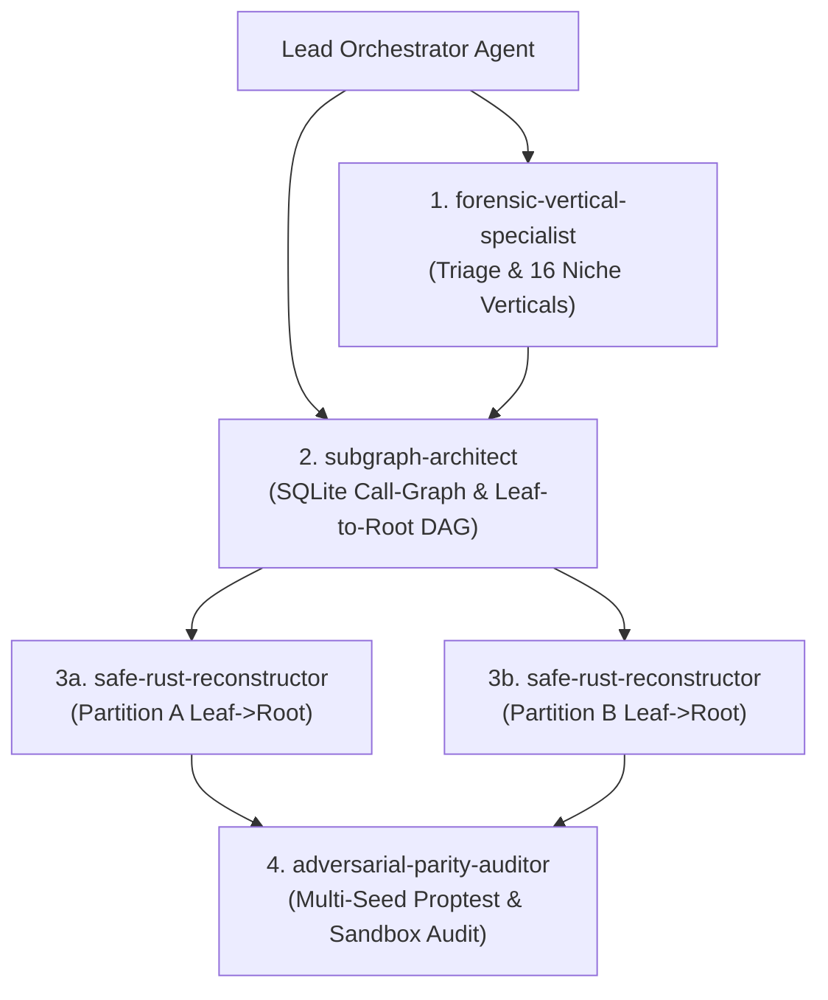

# Antigravity 2.0 Super-Swarm Orchestration Guide

`ArgonZeroG` ships 4 domain-specialized Antigravity 2.0 subagents in `plugins/rea-argonaut/agents/` to parallelize binary triage, call-graph extraction, `#![forbid(unsafe_code)]` Rust reconstruction, and adversarial property-based parity auditing.

---

## 1. The 4 Bundled Swarm Subagents

| Agent Name | Definition File | Primary Responsibility | Permitted MCP Tools |
| :--- | :--- | :--- | :--- |
| **`forensic-vertical-specialist`** | `agents/forensic-vertical-specialist.md` | Rapid pre-decompilation triage across all 16 specialized binary verticals + ELF/PE/Mach-O headers. | `detect_packing_and_yara`, `inspect_go_binary`, `inspect_rust_cpp_binary`, `inspect_wasm_module`, `inspect_jvm_dex`, `inspect_ebpf_object`, `inspect_firmware_blob`, `inspect_engine_archive`, `inspect_python_bytecode`, `inspect_dotnet_assembly`, `inspect_solana_program`, `inspect_evm_bytecode`, `inspect_uefi_image`, `inspect_media_shader`, `inspect_network_capture`, `inspect_retro_binary`, `inspect_binary_layout`, `inspect_pe_resources`, `inspect_macho` |
| **`subgraph-architect`** | `agents/subgraph-architect.md` | Opens native binaries, extracts call-graphs via `decompile_subgraph`, and computes leaf-to-root topological reconstruction schedules. | `open_binary`, `binary_overview`, `list_procedures`, `decompile_subgraph`, `decompile_procedure`, `disassemble_procedure`, `get_cross_references`, `extract_strings`, `export_cfg`, `close_session` |
| **`safe-rust-reconstructor`** | `agents/safe-rust-reconstructor.md` | Translates C/C++ pseudocode and assembly into `#![forbid(unsafe_code)]` idiomatic Rust and proves parity via `verify_rust_parity`. | `decompile_subgraph`, `decompile_procedure`, `disassemble_procedure`, `verify_rust_parity`, `extract_strings`, `get_cross_references` |
| **`adversarial-parity-auditor`** | `agents/adversarial-parity-auditor.md` | Independently stress-tests candidate Rust reconstructions across multiple seeds, high iteration counts (`1000+`), and zero-ULP / bit-exact constraints. | `verify_rust_parity`, `decompile_procedure`, `disassemble_procedure`, `detect_packing_and_yara` |

---

## 2. Parallel Swarm Execution Topology

---

## 3. Swarm Coordination Protocol

### Phase 1: Parallel Triage & Call-Graph Discovery
Spawn `forensic-vertical-specialist` and `subgraph-architect` concurrently:
- `forensic-vertical-specialist` runs `detect_packing_and_yara` and the appropriate niche vertical inspector (`inspect_go_binary`, `inspect_rust_cpp_binary`, `inspect_engine_archive`, etc.) to identify compiler toolchains, packing, and embedded resources.
- `subgraph-architect` calls `open_binary({ path, provider_id: "auto" })`, `binary_overview({})`, and `decompile_subgraph({ procedure, max_depth: 3, max_nodes: 50, traversal: "bfs", include_assembly: true })`.
- Because `BinaryCacheStore` uses SQLite WAL mode keyed by `binary_sha256`, every decompiled node is immediately persisted for zero-latency reads by downstream agents.

### Phase 2: Partitioned Leaf-to-Root Safe Rust Reconstruction
Divide the `topological_order` leaf-to-root schedule into independent subgraph partitions and assign each partition to a `safe-rust-reconstructor` instance:
- Each `safe-rust-reconstructor` translates procedures strictly from leaf callees upward to the root entrypoint.
- Every reconstructed function must enforce `#![forbid(unsafe_code)]` (`forbid_unsafe: true`) and pass `verify_rust_parity` (`status: "verified_bit_exact"`).
- If `verify_rust_parity` returns `"diverged"`, the reconstructor inspects `counterexample.shrunk_inputs`, `counterexample.bit_diff_summary`, and `counterexample.ulp_distance` to patch the boundary bug and re-verify.

### Phase 3: Independent Adversarial Sign-Off
Hand the verified Rust source and target symbols to `adversarial-parity-auditor`:
- The auditor runs `verify_rust_parity` with `forbid_unsafe: true`, `iterations: 1000`, and distinct PRNG seeds (`seed: 3735928559`, `seed: 42`).
- Rejects any candidate where `memory_safety.candidate_unsafe_blocks > 0`, `status !== "verified_bit_exact"`, or `sandbox_telemetry.isolation_active !== true`.
